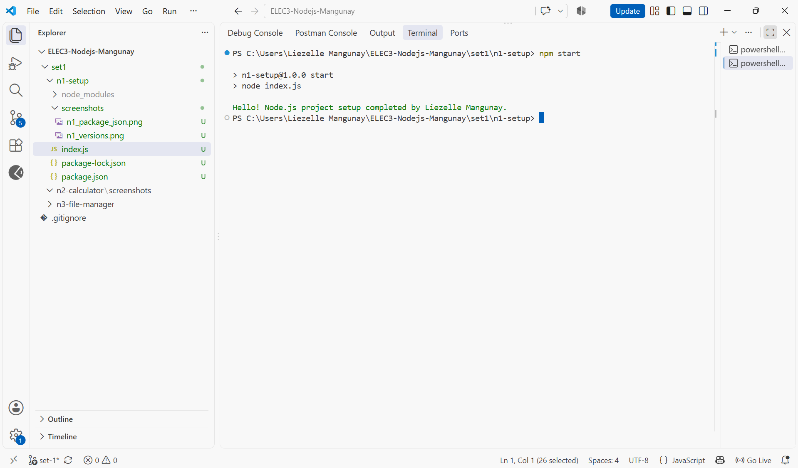
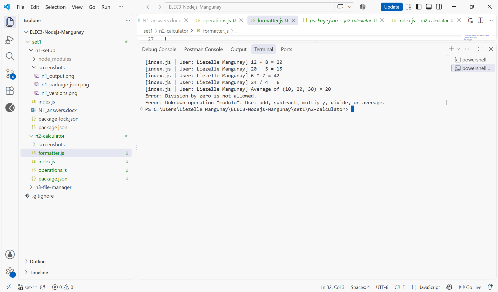
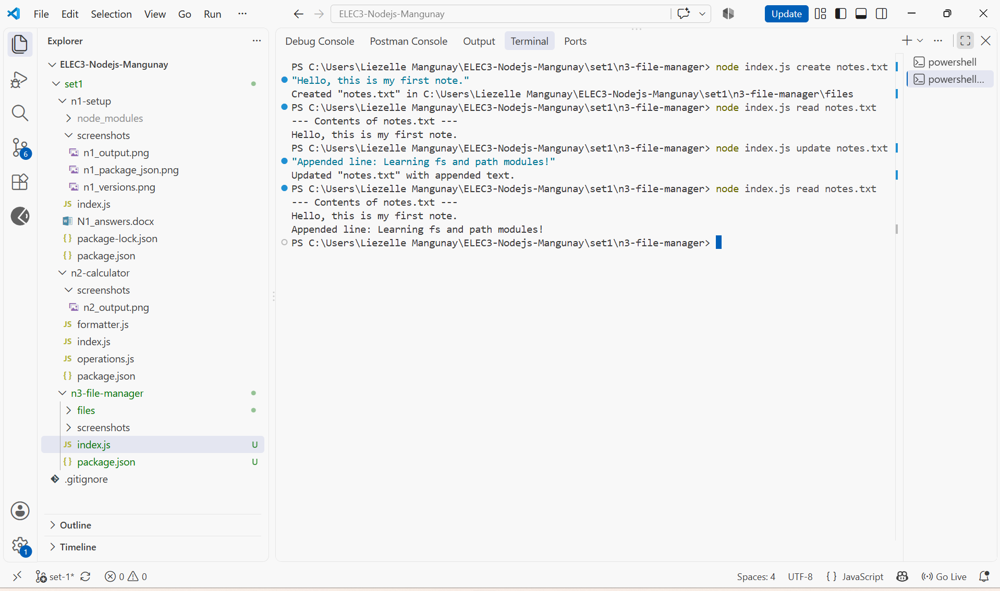
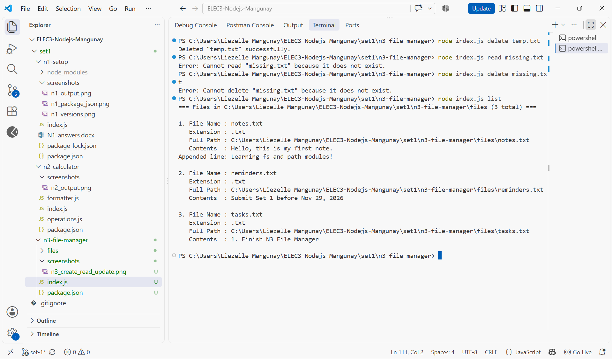

# ELEC 3 - Node.js

- **Student Name:** Liezelle Mangunay
- **Section:** IV BSIT-C
- **Course Code & Title:** ELEC 3 - Node.js
- **Repository:** [ELEC3-Nodejs-Mangunay](https://github.com/mangunayliezelle18-cmd/ELEC3-Nodejs-Mangunay)

---

## Set 1 Activities

| Activity | Description | Folder Link | How to Run |
| :--- | :--- | :--- | :--- |
| **N1: Project Setup and Package Management** | Initializes a Node.js project with `package.json`, dependencies, and a start script. | [`set1/n1-setup`](set1/n1-setup/) | `cd set1/n1-setup && npm install && npm start` |
| **N2: Modular Calculator** | Command-line calculator built with custom CommonJS modules (`operations.js`, `formatter.js`) and built-in modules. | [`set1/n2-calculator`](set1/n2-calculator/) | `cd set1/n2-calculator && node index.js add 12 8` |
| **N3: File Manager with `fs` and `path`** | CLI file manager supporting create, read, update, delete, and list operations inside a `files` directory. | [`set1/n3-file-manager`](set1/n3-file-manager/) | `cd set1/n3-file-manager && node index.js list` |

---

## Set 1 Sample Outputs

### N1: Project Setup and Package Management

### N2: Modular Calculator

### N3: File Manager with `fs` and `path`

